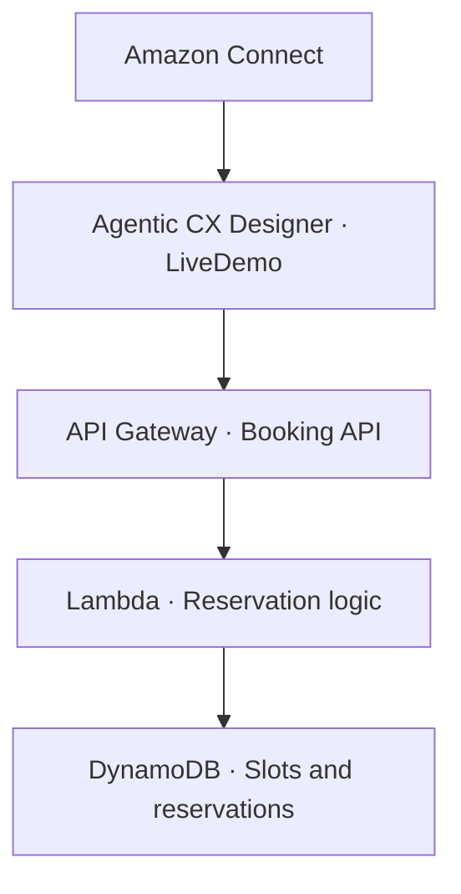

# AWS Agentic Spock

Spock is a voice-first Amazon Connect demo that turns a conversation into a real reservation. A caller can check the schedule, book a slot, ask how Spock works, and change the reservation in the same conversation. The booking reference stays the same when the time changes.

> “Book the first available slot. Before we change it, what’s powering this? Actually, move it to Thursday afternoon.”

## What’s implemented

- **Caller routing.** Spock opens with a greeting and recognizes potential clients, recruiters, and visitors who want to try the demo. If the intent is unclear, it asks a follow-up question.
- **Live booking.** The `LiveDemo` flow uses three Designer data requests to check availability, create a reservation, and reschedule it. Spock reads back the proposed time and asks for confirmation before making a change.
- **Reservation integrity.** DynamoDB transactions prevent two callers from claiming the same slot. A move reserves the new slot and releases the old one in a single transaction. Booking revisions protect against stale updates, and repeated requests resolve to the existing reservation.

The demo calendar offers 30-minute weekday slots at 11 a.m. and 2 p.m. Eastern over a rolling 14-day window.

## Architecture



CloudFormation provisions the booking stack in Oregon (`us-west-2`). A webhook credential stored in AWS Secrets Manager and referenced from Designer authenticates API calls.

## Run the booking demo

The installer expects an existing Agentic CX Designer app named **AWS Agentic Spock**, with **SpockWelcome** as its welcome flow and **LiveDemo** attached. You’ll need Node.js 20 or newer, AWS CLI v2 with access to the target account, and a Designer API key with workspace access.

1. Create `.spock.env` next to the installer with your own AWS account ID, Designer workspace ID, and Designer application ID. The file is ignored by Git.

   ```bash
   SPOCK_AWS_ACCOUNT_ID=your-account-id
   SPOCK_WORKSPACE_ID=your-designer-workspace-id
   SPOCK_APPLICATION_ID=your-designer-application-id
   ```

2. Run the installer from the project folder with the target AWS CLI profile active.

   ```bash
   bash spock-booking.sh
   ```

   Enter your Designer API key at the hidden prompt. The installer checks the target account and app, deploys the stack, and tests the API with isolated reservations before wiring the tools into `LiveDemo` and creating a Designer build.

3. When Terminal prints `READY FOR DESIGNER TEST`, open the app’s **Test** tab. Ask to try the demo, book and confirm a slot, ask what powers the experience, then request and confirm a different time. Verify that the same booking reference appears with the new slot and revision `2` in DynamoDB.

## In progress

The booking journey is the first end-to-end feature. The next pieces are portfolio-grounded client and recruiter conversations, opt-in SMS booking confirmations, and a private post-call summary.
